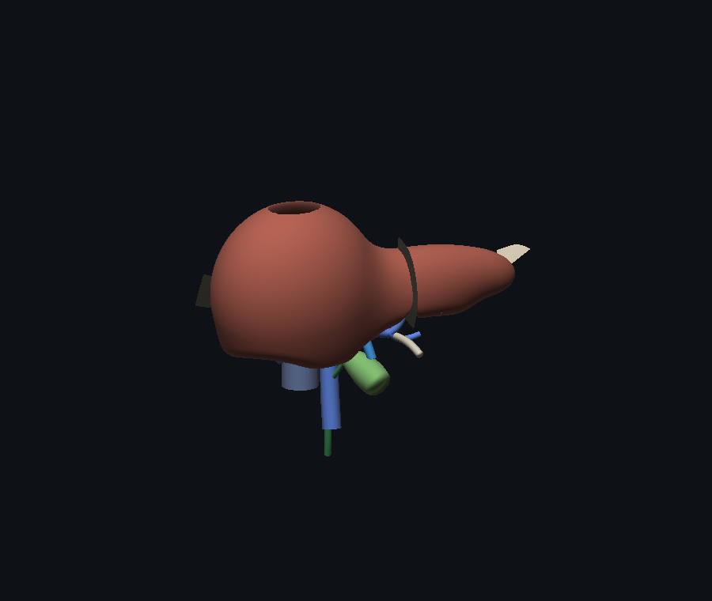
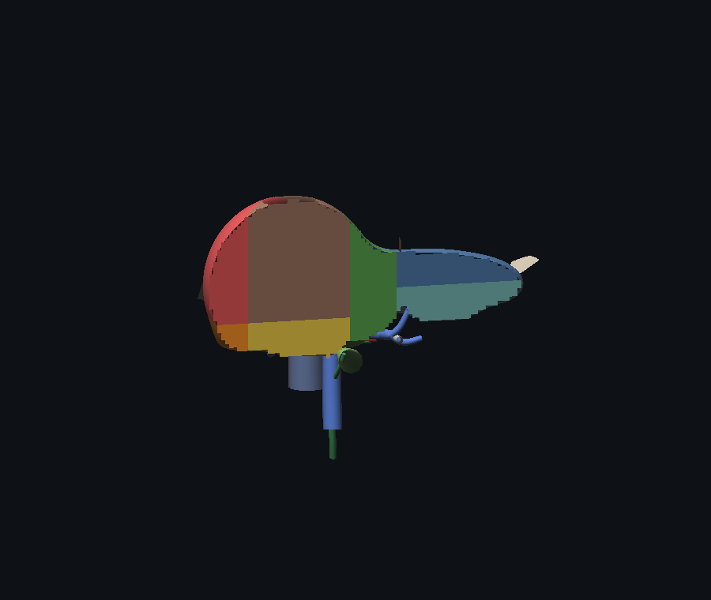

# 肝脏三维解剖模型（交互式 · Couinaud 八段）

## 手动强制合并

开启「多选模式」，按 Ctrl/Shift（Mac 可用 ⌘）点击三维部件或树中条目增减选择；普通点击只选当前部件。选中至少两件即显示「强制合并选中部件」。不限制颜色、形状、距离或既有标签；先统一坐标系，再合并几何、隐藏原件、重新编号并打开新件标签编辑。验证三角形数、索引范围及属性有限值。原标签仍存于原ID，新件保留来源ID但不自动继承冲突的解剖结论。支持门静脉系统、肝静脉系统、肝动脉系统、胆道系统、下腔静脉、肝实质六项人工归类。

「还原37部件」恢复原始拆分（不是单步撤销）。本次合并布局只在当前页面会话生效；标签和来源记录可保存/导出，但刷新页面不会自动重建手动合并布局。几何合并不焊接断口、不生成连接组织。

## 科学性修订（以本节为准，取代下文历史合并演示的推断）

自动合并现在跳过无颜色证据、混色/未知系统及已有人工记录的部件；不再降级为纯几何自动合并。测试环境缺少贴图时保留37件是正确结果，不能以部件数量减少证明科学性。合并部件保留sourcePartIds供追溯。点击面板标明颜色候选、人工标注或证据不足；人工标注也不意味着独立医学审核。未经尺寸校准的包围盒显示模型坐标，不作为毫米测量。整体合并只统一显示，不焊接、不补洞，不保证消除深度冲突或恢复真实解剖。

## 解剖整理与教学分区升级

- 「按解剖系统着色」使用原始图集 UV 像素的主色投票，蓝/红/绿仅产生静脉/动脉/胆道候选。无图、混色、棕红实质或不明确颜色保留未分类。所有静脉统一蓝 #2878d0；红 #ef5350、绿 #40bb71 为本应用配色约定，并非医学诊断或国际唯一色值标准。关闭开关恢复原贴图与色调。
- 部件树含肝实质、第一肝门（门静脉/肝动脉/胆道）、第二肝门（肝静脉）、下腔静脉、待确认静脉及未分类。肝实质不等同于 Glisson 系统。点部件在右侧「解剖归类」保存系统和人工肝段；无需先命名。记录随现有 localStorage/JSON 导入导出，人工归类优先。
- Couinaud 控件默认关闭。先将已确认的实质部件归类为「肝实质」，再开启教学分区，校正左右/上下/前后轴及反向、平面阈值。交线由平面与网格三角面真实求交，点选按命中点显示左外侧区 II/III、左内侧区 IV、右前区 V/VIII、右后区 VI/VII。I 段必须独立人工标注。整个实质块可能跨多个肝段，不能据其中心点认定全块所属。
- 八段不等于八条表面线。此 GLB 无经验证的门静脉灌注分区或医学配准，坐标输出始终注明教学估计；校准确认不代表医学验证。要达到临床准确的八段分割，须提供经专家审核的分段网格/体素标签或血管与标志点数据。
- 系统着色与整体合并显示互斥，前者需要按部件材质显示；分段交线附着于实质部件，整体模式隐藏独立部件时也会隐藏交线。

医学依据：[肝脏外科解剖综述（2023）](https://pmc.ncbi.nlm.nih.gov/articles/PMC10378601/)，支持 Glisson 鞘、肝门与功能肝段的区别；不能用来验证本 GLB 的自动候选。

验证：`node tools/test-app.js`、`node tools/test-anatomy-systems.js`、`node tools/test-anatomy-segments.js`。前者使用真实模型和模拟 DOM/GPU，后两者验证真实 THREE UV 变换、树、持久化集成及交线/坐标数学；没有完成浏览器像素截图验收。


一个**纯前端、零依赖**的肝脏三维解剖教学模型：肝实质由隐式曲面（SDF + Surface Nets）程序化生成，肝内血管、胆道、胆囊与韧带按解剖学位置逐条建模，支持**剖切**、**分段展开**、**点击查看解剖要点**。



---

## 1. 打开方式

**A. 外部 GLB 模型（models/sm_liver_cross_section.glb）**

- **双击 `liver-model.html`**（9.06 MB，单文件版：three.js／GLTFLoader／OrbitControls／几何／数据／样式／图片，以及 **6.11 MB 的 GLB 已用 base64 内嵌**，所以在 `file://` 下也能直接加载，不需要服务器）。
- 或者起一个本地服务（推荐用于继续改代码）：
  ```bash
  node tools/serve.js          # → http://127.0.0.1:8123/
  ```
  然后访问 <http://127.0.0.1:8123/index.html>（分模块版，GLB 走 `./models/`）。
  > 直接双击 `index.html` 时，浏览器会拦截 `file://` 下的 `fetch`，GLB 加载会失败并在页面上给出提示——这是浏览器的同源策略，不是代码问题。

**B. 内置程序化解剖模型**：同一页面左上角「模型来源」可切换；它不依赖任何外部文件。

- 需要浏览器支持 WebGL。若页面打不开 3D，页面会直接显示原因（脚本加载失败 / 无 WebGL / 初始化异常），并附上离线渲染图。
- 修改源码后重新打包：`node tools/build-single.js`（小体积版）／`node tools/build-single.js --glb`（内嵌 GLB 版）。

```
liver-3d/
├─ liver-model.html        单文件版（含内嵌 GLB，双击即用）
├─ liver-3d.html           单文件版（不含 GLB，0.92 MB）
├─ index.html              分模块版入口（GLB 走 ./models/，需 http）
├─ models/
│  └─ sm_liver_cross_section.glb   6.11 MB，31,646 顶点 / 50,000 三角形，1 个网格
├─ css/app.css
├─ js/
│  ├─ liver-geometry.js    肝实质 SDF、Surface Nets、Couinaud 分段、剖切面、管道生成
│  ├─ liver-data.js        解剖学内容与文献表
│  └─ app.js               三维场景、GLB 加载、交互、信息面板、自诊断
├─ vendor/
│  ├─ three.min.js         three.js r147（UMD）
│  ├─ GLTFLoader.js        r147 examples/js 版（挂在 THREE 上）
│  └─ OrbitControls.js     r147 examples/js 版
├─ tools/
│  ├─ serve.js             本地静态服务器（GLB 需要 http）
│  ├─ build-single.js      打包单文件（--glb 内嵌模型）
│  ├─ inspect-glb.js       直接解析 GLB 容器，打印节点树/材质/包围盒
│  ├─ mock-test.js         前端逻辑冒烟测试
│  ├─ diag-scene.js        用真实 three.js 复算相机与视锥
│  └─ diag-nan.js          扫描所有几何体的 NaN
└─ REFERENCES.md
```

---

## 1.5 外部 GLB：怎么加载、怎么取景、怎么看到节点树

- **加载**：`THREE.GLTFLoader().load('./models/sm_liver_cross_section.glb')`。
- **居中与缩放**：加载后先算一次 `Box3`，把最长边缩放到 **24 个场景单位**（与内置模型同量级），再把包围盒中心平移到世界原点。
- **自动取景**：用 `fov` 与画布宽高比分别算出「装下高度」与「装下宽度」所需距离，取较大者 ×1.35 作为相机距离，沿 (0.45, 0.3, 0.85) 方向摆放，`controls.target` 指向包围盒中心。
- **光照**：`AmbientLight(0xffffff, 0.55)` + 主 `DirectionalLight(0xffffff, 1.5)`（右上前方）+ 一盏补光 + 半球光。
- **交互**：`OrbitControls`（左键旋转、滚轮缩放、右键平移，开启阻尼与自动旋转开关）。
- **控制台输出**：加载完成后打印
  1. 整棵节点树（类型 / 名称 / 每个 mesh 的顶点数、三角形数、材质名）；
  2. `console.table` 网格清单；
  3. 材质与对象数统计；
  4. 结论：**这个 GLB 只有 1 个网格**，血管与肝主体未分件。
  另外 `window.__liver = { scene, camera, controls, glbModel, pickables, stats }` 可直接在控制台取用。

### 1.7 手动打标签（把几何部件变成解剖结构）

拆分出来的 37 个部件只是几何连通块，语义由你自己定义：

1. **点选部件**（3D 里单击，或左侧「GLB 部件」列表）→ 右侧面板出现【编辑医学标签】表单：名称、拉丁文、解剖学要点（每行一条）、临床要点（每行一条）。
2. **保存** → 名称绑定到该 `Mesh`（`mesh.userData.displayName` / `label`），左侧列表同步改成你写的名字（已命名的条目高亮）。
3. **再点这个部件** → 面板直接显示「门静脉」＋你填的解剖学要点 / 临床要点；需要改时点【编辑标签】。
4. **持久化**（三选一，自动叠加）：
   - **localStorage**：每次保存自动写入 `liver3d.labels.v1`，刷新不丢；
   - **JSON 文件**：用 `node tools/serve.js` 起服务后，保存会 `POST /api/labels`，直接写进 `models/liver-labels.json`；页面启动时优先读取它；
   - **手动导入/导出**：面板底部「导出 JSON」「导入 JSON」，`file://` 环境下也能靠导出的文件迁移标签。
5. **稳定 ID**：标签按「三角形数 + 包围盒中心（mm 取整）」生成的 ID 绑定，即使拆分顺序变了也能对上（面板里会显示这个 ID）。

数据格式（`models/liver-labels.json`）：

```json
{
  "version": 1,
  "model": "sm_liver_cross_section.glb",
  "updatedAt": 1793807992034,
  "labels": {
    "p6346_-24_34_-9": {
      "name": "门静脉",
      "latin": "vena portae",
      "bullets": ["由肠系膜上静脉与脾静脉汇合而成", "运送全部胃肠道与脾的静脉血"],
      "clinical": ["门静脉高压时管径增宽"],
      "tris": 6346,
      "partIndex": 0,
      "updatedAt": 1793807992034
    }
  }
}
```

> 想分别点击血管/肝实质的话：这份模型本身只有一个 mesh。**代码里已经做了自动拆分**（见 1.6），再配合本节的手动标签即可获得语义。

### 1.8 与内置解剖知识库联动

打标签时，只要名称能对上内置知识库（`js/liver-data.js` 里的 32 条结构 + 8 个肝段 + 16 个表面形态），就会**自动填入解析学要点 / 临床要点 / 拉丁文 / 文献**：

- 输入框下方实时提示：`✓ 知识库匹配：门静脉主干（vena portae hepatis）`
- 点【保存】时：若「解剖学要点」「临床要点」为空 → 自动从知识库填入，并记录 `kbId` 与 `refs`；
- 也可以随时点【从知识库填入】覆盖式填入；
- 已命名的部件再次点开时，面板会显示知识库的要点和文献编号（并注明来自哪个知识库条目）。

匹配规则（从高到低）：中文全名 → 中文基名（去掉括号）→ 括号内别名（如「Ⅰ段（尾状叶）」可用「尾状叶」命中）→ 拉丁文 → 英文 → 包含关系。实测：

| 输入 | 命中 |
|---|---|
| 门静脉 | 门静脉主干 |
| 肝右静脉 | 肝右静脉 |
| vena portae | 门静脉主干（拉丁文匹配） |
| 尾状叶 | Ⅰ段（尾状叶）（括号别名） |
| 胆囊管 | 胆囊管 |
| 下腔静脉 | 下腔静脉（肝后段） |
| 乱写的名字 | 无匹配 → 手动填写 |

保存后左侧列表**立即**显示你写的名字（已命名条目高亮，标题显示「37 · 已命名 N」）。

### 1.9 写实化：材质 / 光影 / 色彩 / 环境贴图 / 部件描边

### 1.9.2 智能解剖合并（把被切断的血管拼回一根）

37 个部件里有不少其实是**同一根血管被拆成的几段**（例如部件 13/14/15）。左侧「智能合并血管」按钮会自动识别并拼回。

判据（四个条件同时满足才合并）：

| 条件 | 实现 |
|---|---|
| ① 颜色接近 | GLB 只有一个材质，无法按 material 区分；改为**从 baseColor 贴图按 UV 采样每个部件的平均色**，RGB 距离 < 0.16 才合并（静脉蓝 / 动脉红 / 胆管绿因此不会互串） |
| ② 空间相接 | 两个 AABB 的间隙 ≤ 模型尺寸的 2.2%（几何模式下降为 0.66%） |
| ③ 都是细长型 | 最长边 / 次长边 ≥ 2.0 |
| ④ 首尾相接的同轴段 | 长轴必须是同一个坐标轴、横向偏移 ≤ max(管径×1.8, 平均长度×0.34)、沿轴错开 ≥ 平均长度×0.32 —— 分叉的两支轴线明显错开，因此不会被并掉 |

合并用 `BufferGeometryUtils.mergeBufferGeometries`，并在合并后**断言三角形总数不变**（不等则放弃该组）。合并会重建部件数组、索引与左侧列表；「还原 37 部件」可完全恢复。

无法采样贴图颜色时（canvas 被禁用）会自动退化为**纯几何判定**（要求轴向余弦 ≥ 0.93、间隙 ≤ 0.66%），避免把不同血管连成一大团。

实测（`node tools/test-app.js`，Node 环境无贴图颜色 → 最激进的情形）：

```
[merge] 37 个部件 → 28 个（合并了 2 组；三角形 50000 → 50000）
[merge] 已还原为 37 个独立部件
```


GLB 自带 baseColor（JPEG）与 **normalTexture**（PNG），但没有 roughnessMap。之前显得扁平，两个原因：**环境光过亮（0.55）**，以及**主光几乎与相机同向**（都在右上前方），正面被均匀照亮就没有明暗交界线。

| 项目 | 做法 |
|---|---|
| 材质 | `roughness` 夹在 **0.7–0.8**，`metalness = 0`，`envMapIntensity = 0.85`，`polygonOffset` 让描边压在表面之上 |
| 法线 | 自带 `normalMap` 启用并加强到 `normalScale = 1.45`；若没有则程序化生成噪声法线 |
| 粗糙度 | 模型没有 `roughnessMap` → 程序化生成 256² 噪声粗糙度贴图（repeat 4×4），让高光有细微起伏 |
| 色彩 | baseColor 做 **22% 去饱和**；另外每个部件有 ±5% 的轻微色差（贴图模式下也保留） |
| 环境光 | `AmbientLight` 0.55 → **0.08**，半球光 0.22 → 0.14 |
| 主光 | `DirectionalLight` **3.1 暖白，位于左上前方**(-58, 54, 30)，**castShadow**（2048² PCFSoft，±26 正交阴影相机，`normalBias 0.03`） |
| 补光 | 冷色补光 0.22（右侧，仅压死黑）+ 背后轮廓光 0.5（勾边） |
| 环境贴图 | `RoomEnvironment` + `PMREMGenerator` → `scene.environment` |
| 色调映射 | `ACESFilmicToneMapping`（曝光 1.0） |
| 阴影 | 每个部件 `castShadow = receiveShadow = true`；`material.shadowSide = FrontSide` + 阴影相机贴合模型包围盒（`normalBias 0.06`）——解决双面材质自遮挡产生的灰色斑块 |
| 深度冲突 | 只有「合并出来的切面 / 碎片」带 `polygonOffset`（factor 4/6），普通部件不偏移，避免共面打架 |
| 碎片 | 拆分时 <100 三角形的碎肉块合并成 1 个部件，**默认显示**；加载完成后还会用 `BufferGeometryUtils.mergeBufferGeometries` 把这 20 块碎片再合并一次成独立 Mesh（1,299 三角形），材质与周围组织完全一致（无色差、无透明、无线框），用来填补血管交汇处的缝隙。合并前后三角形数做**硬断言**（不等则放弃合并） |
| **部件描边** | 默认**完全关闭**。勾选「显示所有部件缝隙」时用 `#5a2e25`、opacity 0.4 的深红褐细线；**选中部件不再画任何线**，改为极暗暖色自发光（`#4a3410` × 0.45）＋略微更光滑（roughness ×0.85），点空白处立即恢复纯净 |

调参入口都在 `js/app.js`：`DESAT`、`prepareGLBMaterial()`、`makeNoiseTexture()`、`buildBoundaryLineGeometry()`、`setupEnvironment()`、以及 `init()` 里的光照数值。

### 1.9.1 平滑无缝模式（解剖学视觉合并）

拆分是为了点击，但 37 个零件在视觉上会露出接缝、色差与暗色碎块。所以额外提供**合并回整体**的显示模式：

| 项目 | 做法 |
|---|---|
| 合并 | 加载后调用 `BufferGeometryUtils.mergeBufferGeometries(37 个部件几何, false)`，得到 1 个 **50,000 三角形**的整体网格（与原模型完全一致） |
| 材质 | 单独克隆一份：`color = 白`（去掉各部件 ±5% 色差）、无自发光、`roughness 0.75`、`metalness 0`、`transparent = false`、`depthWrite = true`、`DoubleSide` |
| 开关 | 左侧「平滑无缝模式（合并为整体）」。开 → 隐藏 37 个零件、只显示整体；关 → 隐藏整体、恢复 37 个零件（点击逻辑完全不变） |
| 拾取 | 整体网格 `userData.kind = 'seamless'`，点它会弹出说明（提示关闭该开关即可编辑单个部件） |

实测（`node tools/test-app.js`）：

```
[seamless] 已把 37 个部件合并为整体：50,000 三角形
seamless ON  -> whole visible: true  | parts visible: 0
seamless OFF -> whole visible: false | parts visible: 37
```

### 1.6 自动拆分：从 1 个 mesh 到 37 个可点击部件

加载完成后 `app.js` 会对每个 mesh 做一次**连通分量分析**（并查集，按共享顶点归并三角形）：

| 阶段 | 结果 |
|---|---|
| 原始连通壳（shell） | **523** 个 |
| 近似平面的壳（切面片，最小边 < 模型尺寸的 1.2%） | 468 个 → **合并为 1 个「切面」部件**（20,849 △） |
| 立体壳 ≥100 三角形 | **35** 个（各自独立成部件） |
| 立体壳 <100 三角形 | 20 个 → 合并为 1 个「碎片」部件（1,299 △） |
| 合计 | **37 个部件，三角形总数恰好 50,000（零丢失）** |

交互：
- 左侧「GLB 部件」面板列出全部部件（色块 + 三角形数），点击即选中；
- 3D 里直接单击也可选中，右侧显示三角形数、形状（块状/细长/扁平）、包围盒尺寸与中心；
- 三个开关：**按部件着色**、**只显示选中部件**（隔离查看）、**线框显示**；
- 控制台里 `window.__liverParts[i].mesh` 就是 `THREE.Mesh`，可直接挂事件。

> 说明：这些「部件」是网格的连通壳，多数对应导出时的 UV/材质接缝，**并不等于解剖命名**。要得到「门静脉 / 肝静脉 / 肝实质」这种语义分区，需要分件模型，或按解剖先验做区域切分。

---


---

## 2. 四项需求的实现

### 需求 1：肝内形态结构齐全

| 类别 | 已建模内容 |
|---|---|
| 肝叶／肝段 | 右叶、左叶、方叶（Ⅳ段）、尾状叶（Ⅰ段）；Couinaud Ⅰ–Ⅷ 段（可着色、可单独点击、可分离） |
| 表面形态 | 膈面、脏面、肝下缘、裸区；肝门（横沟）、肝圆韧带裂、静脉韧带裂、胆囊窝、下腔静脉沟 |
| 脏面压迹 | 右肾压迹、肾上腺压迹、结肠压迹、十二指肠压迹、胃压迹、食管压迹 |
| 门静脉系 | 门静脉主干、右支、左支（横部／脐部）、右前叶支、右后叶支、Ⅴ/Ⅵ/Ⅶ/Ⅷ 段支、Ⅱ/Ⅲ/Ⅳ 段支、尾状叶支 |
| 肝静脉系 | 肝右静脉、肝中静脉、肝左静脉、肝右副静脉（右后下静脉）、尾状叶静脉、下腔静脉肝后段 |
| 肝动脉系 | 肝固有动脉、肝右动脉、肝左动脉、胆囊动脉 |
| 胆道 | 肝右管、肝左管、肝总管、胆囊管、胆总管 |
| 胆囊 | 底、体、颈／漏斗部（由变径管道表达） |
| 韧带／腹膜 | 镰状韧带、肝圆韧带、静脉韧带、左三角韧带、右三角韧带 |

共 32 条管道结构 + 8 个肝段 + 16 个可点击的肝表面形态。

### 需求 2：可以把肝“打开”看内部（含血管）

三种互补的方式：

1. **剖切滑块**：肝实质被一个额状面剖开，剖面按 Couinaud 分段着色（这张“剖面图”本身即教学重点）；被切断的血管、胆管在剖面上显示为圆形断端。
2. **半透明肝实质**：整块肝变透明，门静脉、肝静脉、肝动脉、胆道在三维空间中直接可见。
3. **分段展开**：8 个肝段沿各自方向分离，段间界面（三条肝静脉 + 门静脉横裂平面）一目了然。



### 需求 3：点击显示解剖学重点

- 点击**肝段**→ 段名、拉丁文、英文、解剖要点、临床要点、依据文献；若点击处正好落在某个命名形态（如右肾压迹）上，则显示该形态的要点并标注它属于哪个肝段。
- 点击**血管／胆管／胆囊／韧带**→ 同名信息面板（起点、行程、属支、变异、临床意义）。
- **悬停**显示结构名称；可打开“显示名称标注”，把 16 个关键结构名投影到三维视图上。
- 面板底部列出该条目所依据的文献（编号与 `REFERENCES.md` 一致）。

### 需求 4：严格遵循现代解剖学

- 术语采用 **Terminologia Anatomica 第 2 版（TA2, 2019）** 与 **Brisbane 2000** 命名（Strasberg）。
- 肝段划分按 **Couinaud** 体系：三条肝静脉平面 + 门静脉横裂平面 + 尾状叶，与临床影像的分段方式一致。
- 所有数字（管径、长度、容量、变异率）均以文献可查的区间表述，并在 `REFERENCES.md` 中给出出处。
- 明确标注为“示意”的部分见第 4 节（局限）。

---

## 3. 模型是怎么造的

1. **肝实质**：由数个椭球（右叶主体、右叶下部、左叶、左叶尖、尾状叶）以平滑并集（smooth-min）融合，再依次减去
   脏面平面、肝门凹陷、胆囊窝、肝圆韧带裂、静脉韧带裂、下腔静脉沟，以及 6 个浅碟状压迹
   （压迹的球心由射线求交自动贴在真实表面上，保证深度恒定）。
2. **网格化**：在 0.26 cm 的体素网格上采样 SDF，用 **Surface Nets** 生成四边形面片，做 2 次拉普拉斯平滑后
   沿梯度**回投影**到真实等值面，法线直接取 SDF 梯度（比面法线更光滑）。约 1.4 万顶点 / 2.8 万三角形。
3. **分段归属**：对每个顶点代入四个界面方程（肝右／中／左静脉平面 + 门静脉横裂平面）与尾状叶椭球，
   得到 Ⅰ–Ⅷ 段编号；剖面上的每一小块也做同样判定，因此剖面着色与三维着色完全一致。
4. **管道**：每条结构是一串控制点 + 半径序列，经 Catmull–Rom 插值、平行移动标架（parallel transport）
   生成变径管；断端有端盖，便于剖切时读作“管腔”。
5. **剖切**：three.js 的 `clippingPlanes` 做 GPU 裁剪；剖面另用 SDF 采样生成一片带顶点色的网格补上。

模型尺寸（近似成人均值）：横径 24 cm、上下径 13 cm、前后径 10 cm。

---

## 4. 已知局限（请务必连同结论一起阅读）

1. **血管分支是“教学示意”**：走行方向、分支层级、相对位置按解剖学文献设置，但并非某一例真实影像的三维重建，
   分支数量与角度做了简化（例如肝静脉只画到段支级别）。个体变异（尤其肝动脉起源、右后叶门静脉起源）很常见，
   本模型不能替代 CTA/MRCP。
2. **肝段界面是平面近似**：真实段间界面是沿肝静脉和门管蒂的曲面，本模型用平面方程近似。
3. **表面形态经过艺术简化**：肝表面本有更多细小凹凸与压迹，模型保留了具解剖学意义的主要形态。
4. **不是医疗器械**：仅供解剖学学习与演示，不可用于诊断、手术规划或任何临床决策。

---

## 5. 自检

本仓库自带两个 Node 脚本，可在没有浏览器的情况下复核几何与前端逻辑：

```bash
node tools/scene.js --res=0.22 --seg=0 --views="0.4,0.28,0.85" --out=check.png   # 软件光栅化渲染
node tools/mock-test.js                                                          # 前端逻辑冒烟测试
```

- `tools/scene.js` 用纯 JS 光栅化器（z-buffer + Lambert）渲染肝实质、全部管道与韧带，可加 `--cut=<z>` 显示剖面。
  本 README 中的图片即由它生成。
- `tools/mock-test.js` 在 Node 里用最小的 DOM / three.js 桩件运行 `js/app.js`，检查建网格、建血管、
  剖切、分段着色、图层开关、点击取信息等路径是否抛错，并打印生成的信息面板文本。

---

## 6. 参考文献

见 [REFERENCES.md](REFERENCES.md)（每条都标注了核实来源；未能核实的说法已从模型中删除或改写）。
